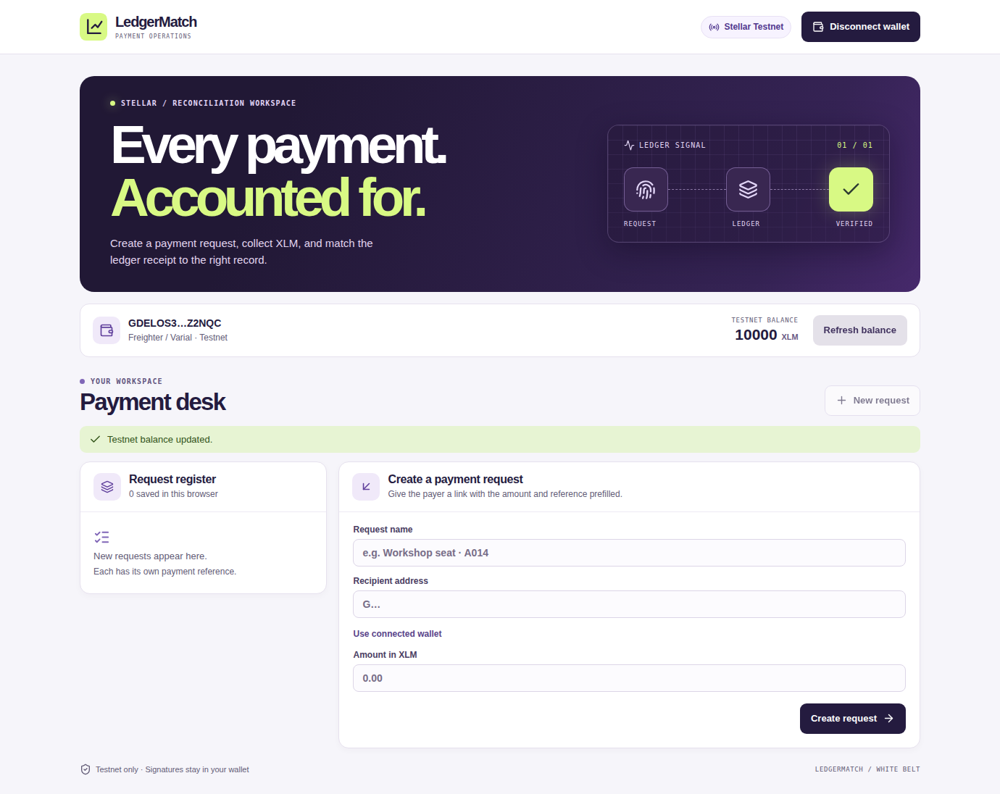
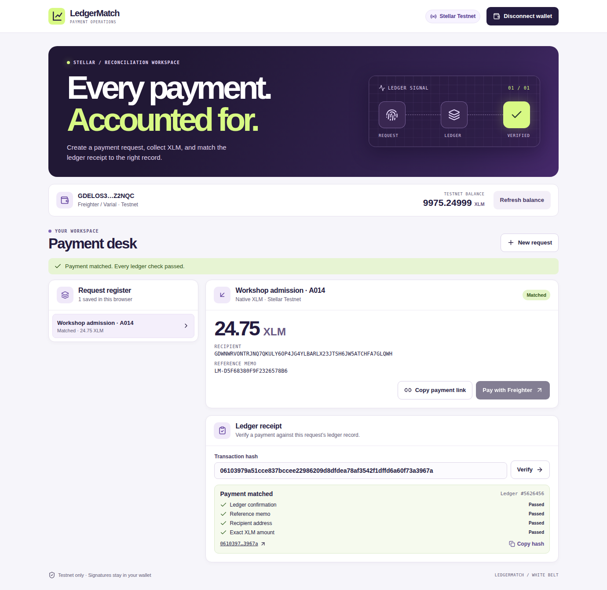
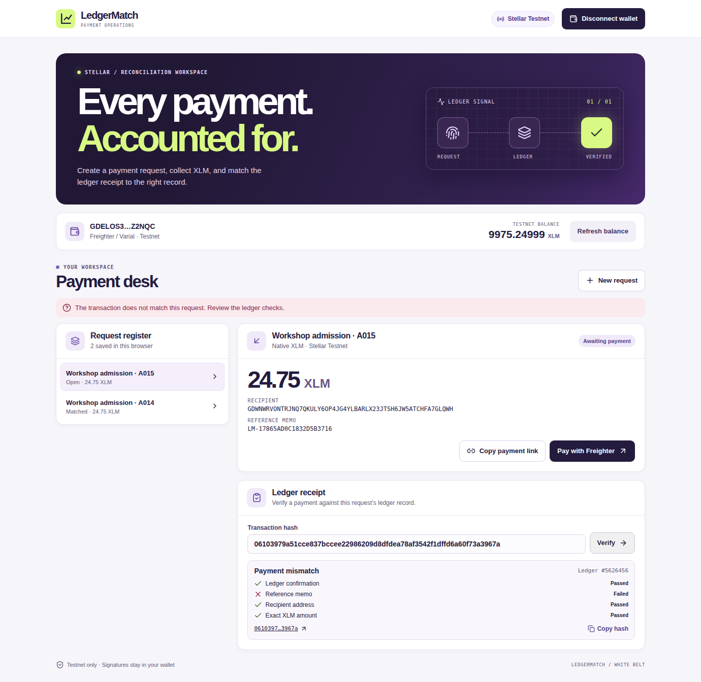

# LedgerMatch

**Payment reconciliation for small event teams, on Stellar Testnet.**

A workshop organizer may have two registrations for exactly 24.75 XLM, both payable to the same wallet. LedgerMatch gives each request a distinct Stellar memo. A payer opens the request and signs in Freighter / Varial. The organizer can verify the transaction hash against the request without connecting a wallet.

[Open LedgerMatch](https://isinsuatay.github.io/ledgermatch/) · [Deployment checks](https://github.com/isinsuatay/ledgermatch/actions)

## Run locally

Requires Node.js 22.12 or later and a desktop browser with the [Varial wallet extension](https://varialwallet.com/) (formerly Freighter).

```bash
git clone https://github.com/isinsuatay/ledgermatch.git
cd ledgermatch
npm ci
npm run dev
```

Open the URL printed by Vite. Set the wallet to **Testnet**. The app shows **Get Testnet XLM** for a new, unfunded wallet. Use two funded Testnet accounts, one to receive payments and one to pay.

```bash
npm test         # Exact amounts, request links, envelope and matching rules
npm run build    # Static files in dist/
npm run preview  # Preview the production build
```

## Demo flow

1. Create two payment requests for the same Testnet recipient and XLM amount. Each receives a unique `LM-…` text memo.
2. Copy a payment link and open it in the payer’s browser. Review the recipient, amount and memo before signing.
3. Connect the payer’s Freighter / Varial wallet, check the Testnet balance, then select **Pay with Freighter** and approve the transaction.
4. After confirmation, the app displays the hash and a ledger receipt. Use **Copy hash** to pass the result back to the organizer.
5. Verify the same hash against the second request. The receipt shows the memo mismatch even though the amount and recipient agree.

## How settlement is checked

- Amounts are converted to integer stroops, the smallest XLM unit, for exact comparison.
- The wallet signs a single native XLM payment on Testnet. LedgerMatch checks the signed envelope against the transaction it built.
- A receipt matches when Horizon reports a successful transaction with the same text memo and exactly one native XLM payment operation to the expected address for the exact amount.
- If the submit result is uncertain, the app saves the hash and blocks another payment from the current request until the transaction can be verified or its time bounds have passed and Horizon has indexed a later ledger.
- Payment links carry public request details in the URL fragment. The register and receipt snapshots are saved in the current browser. A receipt can be independently verified by anyone with the request and transaction hash.

LedgerMatch is a Testnet prototype with browser-local state. A link can be paid from multiple browsers. The register is not a shared accounting system, and a Stellar Testnet reset can remove accounts and old transaction records. Keep personal information out of shareable request names.

## White Belt coverage

| Requirement | In the app |
| --- | --- |
| Freighter wallet and Testnet | Varial SDK connection, Testnet passphrase check, Friendbot funding |
| Connect and disconnect | Wallet controls in the header, with site-access revocation on supported Varial versions |
| XLM balance | Native Testnet XLM in the wallet strip |
| XLM transaction | Wallet signing, Horizon submission, hash and pass/fail feedback |
| Public source and live deployment | This repository and GitHub Pages |
| Development history | Meaningful commits covering request, wallet, payment, UI, tests and deployment |

## Testnet evidence

A browser run used the Varial extension with an isolated Testnet wallet. It exercised wallet connection, Friendbot funding, payment signing, successful receipt verification, a reference mismatch, link sharing and wallet disconnect.

[View the confirmed 24.75 XLM transaction](https://stellar.expert/explorer/testnet/tx/06103979a51cce837bccee22986209d8dfdea78af3542f1dffd6a60f73a3967a) · [Browser verification run](https://github.com/isinsuatay/ledgermatch/actions/runs/42500843848)

### Connected wallet and Testnet XLM balance



### Successful payment and matched ledger receipt



### Same recipient and amount, different reference



## References

- [Varial extension integration](https://github.com/stellar/freighter-developer-docs/blob/main/extension/installation.md)
- [Stellar SDK](https://github.com/stellar/js-stellar-sdk)
- [Stellar Horizon transaction API](https://developers.stellar.org/docs/data/apis/horizon/api-reference/retrieve-a-transaction)
